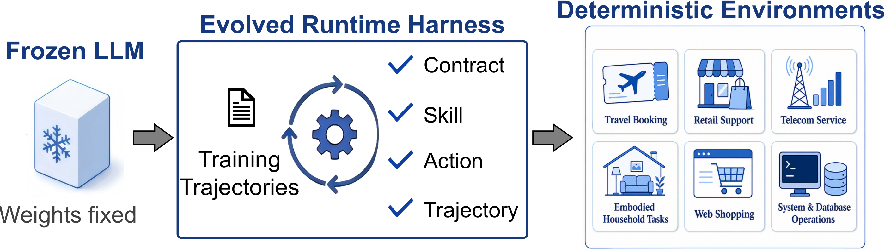
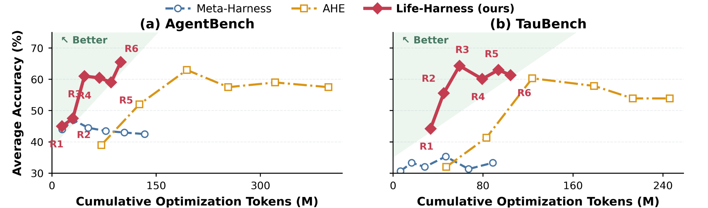
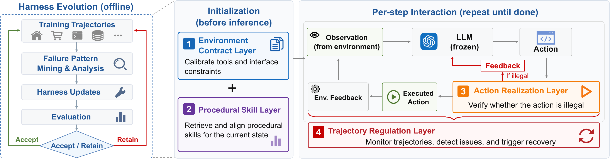

<div align="center">

# Life-Harness (V2)

### Adapting the Interface, Not the Model: Runtime Harness Adaptation for Deterministic LLM Agents

[](#benchmarks)
[](#benchmarks)
[](#results)
[](#results)
[](#why-life-harness)

</div>

<p align="center">
  
</p>

🔥 **V2 Update:** Life-Harness V2 primarily adds **open-source, reproducible evolution workflows** and **comparisons with Meta-Harness and AHE (Agentic Harness Engineering)**.

- 🚀 **Evolve from scratch:** start with an identity harness, iterate on TRAIN tasks, select improvements and evaluate the frozen result on TEST.
- ⚖️ **Compare three methods:** run Life-Harness, Meta-Harness and AHE with native benchmark scoring and recorded method-specific protocols.
- 📊 **Track accuracy and tokens:** retain round results, acceptance decisions, final TEST scores and measured model usage, with missing usage explicitly flagged.
- 🧩 **Evaluate and extend:** evaluate the provided harnesses on AgentBench, TauBench and AppWorld, or connect a new benchmark through the extension API.

## Why Life-Harness

| What changes? | What stays fixed? | Why it matters |
| --- | --- | --- |
| Runtime harness behavior | LLM weights | Adaptation without model finetuning |
| Model–environment interface | Tasks, environment transitions and scoring | Native benchmark evaluation remains comparable |
| Training-derived mechanisms | Frozen harness during held-out evaluation | TEST results do not guide evolution |

## Results

The paper evaluates Life-Harness across **seven main environments and 18 open-weight backbones**, improving **116 of 126** model–environment settings. It also includes frontier-model transfer and additional AppWorld experiments.

With Qwen3-4B-Instruct, the paper reports the following comparison across the seven main environments:

| Comparison | Mean accuracy gain of Life-Harness | Reduction in evolution tokens |
| --- | ---: | ---: |
| Life-Harness vs. Meta-Harness | +28.7 percentage points | 8.5% |
| Life-Harness vs. AHE | +7.5 percentage points | 68.4% |

These are paper results. Newly reproduced scores and token usage are written to the run directories described below.

<p align="center">
  
</p>

## Method

Life-Harness evolves runtime mechanisms from observed TRAIN failures and successful controls, validates proposals, and accepts improvements on the same complete training batch. Accepted mechanisms are frozen for final TEST evaluation.

<p align="center">
  
</p>

| Harness flag | Paper layer | Runtime role |
| --- | --- | --- |
| `h2` | Action Realization | Realize and validate model actions before execution |
| `h3` | Environment Contract | Expose tool and environment constraints at the interface |
| `h4` | Trajectory Regulation | Monitor interaction progress and provide runtime guidance |
| `h5` | Procedural Skill | Inject reusable training-derived skills at task initialization |

The harness master switch controls whether these layers are applied. Per-layer switches support ablations. The [Life-Harness optimizer guide](evolution/life_evolve/README.md) describes the current proposal interface, validation and checkpoint behavior.

## Benchmarks

| Suite | Environments | What this release provides | Start here |
| --- | --- | --- | --- |
| AgentBench | ALFWorld, DBBench, WebShop, OS | Life-Harness evaluation; Life-Harness/Meta-Harness/AHE evolution and comparison | [AgentBench](AgentBench/README.md) |
| TauBench (`τ`-bench / `τ²`-bench) | Airline, Retail, Telecom | Life-Harness evaluation; Life-Harness/Meta-Harness/AHE evolution and comparison | [TauBench](TauBench/README.md) |
| AppWorld | Multi-application API operation | Life-Harness adapter, frozen policies, baseline/ablation evaluation and runtime records | [AppWorld](AppWorld/README.md) |

AppWorld is an additional benchmark beyond the seven main environments. Its fixed-policy Life-Harness evaluation is separate from the six-round Life-Harness/Meta-Harness/AHE comparison controllers.

```text
Life-Harness/
  AgentBench/                # ALFWorld, DBBench, OS and WebShop
  TauBench/                  # Airline, Retail and Telecom
  AppWorld/                  # Life-Harness adapter and frozen AppWorld policies
  evolution/                      # Life-Harness/Meta-Harness evolution and native comparison controllers
  integrations/ahe-native/   # Native AHE adapter and accounting
  assets/                    # Method and result figures
  scripts/                   # Tokenizer setup and frozen-input checks
```

## Quick Start

Choose the benchmark you want to evaluate and follow its setup guide. The environments have separate dependencies and services. Configure model endpoints and credentials in your local process environment.

### Installation guides

Use the shared runtime guides and the rows for your selected benchmarks before launching evolution or evaluation. The commands below install the common comparison dependencies; each benchmark also needs its own data, workers and services.

| Environment / component | What to prepare | Installation guide |
| --- | --- | --- |
| Model endpoints and credentials | Solver/user-simulator endpoints, optimizer gateway and local model/tokenizer paths | [Environment template](evolution/deploy/env.example.sh) |
| Meta-Harness / AHE native runtime | Python 3.13 environment, pinned upstream dependencies and privileged Linux isolation | [AHE runtime setup](integrations/ahe-native/README.md) — also used by Meta-Harness |
| TauBench: Airline, Retail, Telecom | Python environment, native task data and simulator configuration | [TauBench setup](TauBench/README.md#setup) |
| AgentBench common runtime | Core dependencies, AgentRL controller and native workers | [Common runtime setup](AgentBench/NEW_MACHINE_SETUP.md#agentbench-common-runtime) |
| ALFWorld | Extracted game archives and isolated ALFWorld/TextWorld environment | [ALFWorld setup and smoke check](AgentBench/NEW_MACHINE_SETUP.md#alfworld) |
| DBBench | MySQL 8 service and native SQL worker | [DBBench setup and smoke check](AgentBench/NEW_MACHINE_SETUP.md#dbbench) |
| WebShop | Java 11, product data, search index and native environment | [WebShop setup and smoke check](AgentBench/NEW_MACHINE_SETUP.md#webshop) |
| OS interaction | Docker images/services, solver backends and local solver tokenizer | [Docker setup](AgentBench/README.md#setup) and [OS comparison setup](evolution/os_comparison/README.md) |
| AppWorld | Upstream engine, data, simplified agent package and compatible model server | [AppWorld setup](AppWorld/README.md#setup) |

### Shared comparison runtime

For the evolution/comparison runtime, initialize the fixed upstream sources and install TauBench:

If you downloaded an Anonymous GitHub source ZIP, first follow the [ZIP dependency setup](integrations/ahe-native/README.md#setup-from-a-source-zip), then skip the `git submodule update` command below. A source ZIP does not contain the parent repository's Git metadata.

```bash
git submodule update --init --recursive
cd TauBench
uv sync --frozen
cd ..
export PYTHONPATH="$PWD:$PWD/integrations/ahe-native:$PWD/TauBench/src"
TauBench/.venv/bin/python scripts/download_flash_tokenizer.py
TauBench/.venv/bin/python scripts/check_reproduction.py
```

Install the [AHE runtime](integrations/ahe-native/README.md) as well when running the native comparisons; the Meta-Harness transport also uses its isolated execution environment. Set `MR_API_KEY` and `MR_HOST` for the optimizer gateway and `DASHSCOPE_API_KEY` for the TauBench Airline/Retail simulator. Use the [environment template](evolution/deploy/env.example.sh) and [AgentBench native setup](AgentBench/NEW_MACHINE_SETUP.md) for the solver, workers, data and services. `MR_HOST` is the prefix before `/protocol/openai/v1`.

## Start Life-Harness, Meta-Harness and AHE Iteration

The unified runner starts from identity harnesses: Life-Harness begins with empty H2–H5, and Meta-Harness/AHE do not import previously evolved strategies. The native comparison runs use six rounds and retain each method's selection rules. Method-specific schedules and token budgets are recorded; six rounds do not imply equal token consumption.

### Run all three methods

```bash
# Airline, Retail and Telecom.
TauBench/.venv/bin/python -m evolution.reproduce \
  --suite tau --method all --name tau_compare --launch

# ALFWorld, DBBench and WebShop.
TauBench/.venv/bin/python -m evolution.reproduce \
  --suite agentbench --method all --name agentbench_compare --launch
```

Omit `--launch` to prepare the exact command plan without model calls. Adding `--launch` starts optimization and native evaluation. Use a new run name for each experiment.

### Run a selected method

```bash
# Current Life-Harness H2–H5 evolution.
TauBench/.venv/bin/python -m evolution.reproduce \
  --suite agentbench --method life --name life_agentbench --launch

# Original Meta-Harness run_evolve with native evaluation and measured API usage.
TauBench/.venv/bin/python -m evolution.reproduce \
  --suite agentbench --method meta --name meta_agentbench --launch

# Original AHE Debugger/Evolve loop with the native adapter.
TauBench/.venv/bin/python -m evolution.reproduce \
  --suite agentbench --method ahe --name ahe_agentbench --launch
```

For TauBench, use `--suite tau --method life` for Life-Harness or `--suite tau --method meta-ahe` for the paired Meta-Harness+AHE controller. AHE retains upstream selection and uses the adapter's `h2345-budget-restricted-v1` search profile. Its last evolved candidate receives an additional TRAIN measurement without changing selection.

OS uses the [dedicated Docker comparison controller](evolution/os_comparison/README.md):

```bash
TauBench/.venv/bin/python -m evolution.os_comparison.protocol --name os_compare
TauBench/.venv/bin/python -m evolution.os_comparison.launch \
  --root "$PWD/evolution/experiments/os_compare"
```

Low-level Life-Harness proposals and the separate plugin-based Life-Harness/Meta-Harness loops are documented in [evolution/README.md](evolution/README.md). AppWorld provides frozen-policy evaluation; an automatic AppWorld Meta-Harness/AHE evolution controller is not included.

### Final Harness and TEST Results

The Life-Harness iteration drivers automatically seal TRAIN selection and evaluate the selected final harness on the fixed TEST split. They write `training_seal.json` and `FINAL_RESULTS.json`; **no extra evolution command is needed for final TEST scoring**.

For the all-method examples above, Life-Harness results are located at:

```text
evolution/experiments/tau_compare_life_tau/FINAL_RESULTS.json
evolution/experiments/agentbench_compare_life_alfworld/FINAL_RESULTS.json
evolution/experiments/agentbench_compare_life_dbbench/FINAL_RESULTS.json
evolution/experiments/agentbench_compare_life_webshop/FINAL_RESULTS.json
```

The selected H2–H5 chain is recorded in each domain's `runtime/final/manifest.json`, with accepted source artifacts and hashes bound to the TRAIN seal. The provided built-in harness and this newly evolved chain are distinct evaluation targets; use the driver's final records to report the evolved run. TEST outcomes never select candidates.

## Evaluate the Provided Life-Harness

Use the benchmark's native evaluator with the Life-Harness enabled. These commands call the solver; they do not run the evolution optimizer.

**TauBench** — enable the master switch and the desired layers on the held-out split:

```bash
cd TauBench
uv run python scripts/eval_harness.py \
  --domain retail --split test --enabled --h2 --h3 --h4 --h5 \
  --agent-llm "$LIFE_AGENT_MODEL" --agent-api-base "$AGENT_API_BASE" \
  --user-llm "$LIFE_USER_MODEL" --user-api-base "$USER_API_BASE" \
  --trials 1
cd ..
```

Replace `retail` with `airline` or `telecom`. Omitting `--enabled` evaluates the baseline. See [TauBench evaluation](TauBench/README.md) for model, split and ablation options.

**AgentBench** — configure the model and harness switches, start the corresponding task services, then run the assignment:

```bash
cd AgentBench
python -m src.assigner --config configs/assignments/alfworld.yaml
python -m src.assigner --config configs/assignments/dbbench.yaml
python -m src.assigner --config configs/assignments/webshop.yaml
python -m src.assigner --config configs/assignments/os.yaml
cd ..
```

Use the `*-std` task profiles for held-out evaluation. Ensure `enabled: true` (or `harness.enabled: true` for DBBench) in the selected task profile; in particular, the OS profile requires enabling its master switch. Keep the released per-layer settings or explicitly record an ablation. Endpoint, service and output configuration is explained in [AgentBench evaluation](AgentBench/README.md).

**AppWorld** — run the frozen policy on `dev` or a chosen official TEST split, then invoke the upstream evaluator. See [AppWorld final-harness evaluation](AppWorld/README.md#evaluate-the-frozen-life-harness) for the complete commands, baseline comparison and per-layer ablations.

## Apply Life-Harness to Other Benchmarks

The [benchmark extension API](evolution/extensions/README.md) provides a generic Life-Harness runner. Implement a native adapter for tasks, solver requests, environment execution and binary grading; the runner handles H2–H5, candidate validation, TRAIN selection, final TEST and accuracy/token records. No changes to core files are required.

Try the complete offline example first:

```bash
python -m evolution.extensions demo \
  --output evolution/experiments/extension_demo --rounds 2
```

This uses a scripted toy solver and repair proposal without API calls. It demonstrates candidate acceptance, rejection and frozen TEST evaluation, rather than measuring benchmark performance.

For a real benchmark, export a zero-argument adapter class or factory from an importable module, configure the optimizer and native environment, then run:

```bash
TauBench/.venv/bin/python -m evolution.extensions evolve \
  --adapter my_benchmark:MyAdapter \
  --output evolution/experiments/my_benchmark --rounds 6
```

The command starts from empty hooks and automatically evaluates the frozen result on disjoint TEST tasks after TRAIN selection. This extension runner uses the full TRAIN set every round; existing benchmark reproduction drivers keep their native schedules. See the [extension guide](evolution/extensions/README.md) for adapter contracts, a runnable implementation, separate frozen-harness evaluation, model usage accounting and output locations.

## Accuracy and Token Records

Collect current results during or after a unified run, including interrupted runs:

```bash
TauBench/.venv/bin/python -m evolution.reproduce \
  --suite tau --method all --name tau_compare --report
TauBench/.venv/bin/python -m evolution.reproduce \
  --suite agentbench --method all --name agentbench_compare --report
```

| Record | Location / contents |
| --- | --- |
| Exact protocol and commands | `evolution/experiments/NAME/reproduction.json`; child protocol and schedule files |
| Accuracy and round state | `REPRODUCTION_RECORDS.json`; original incumbent/candidate results, acceptance decisions and final TEST records |
| Optimizer tokens | Native usage summaries and per-request ledgers, including rejected proposals, failed calls and repairs |
| Solver/simulator/judge tokens | Separately labeled native records where available; excluded from optimizer-only totals |
| Incomplete accounting | Missing provider usage is marked unknown; measured usage and any native estimates remain separate |

Life-Harness/Meta-Harness outputs are under `evolution/experiments/`; standalone AHE outputs are under `integrations/ahe-native/{batches,experiments,heldout_tests}/`. `reproduction.json` lists the exact locations. OS and AppWorld retain their native evaluation and usage records as described in their guides. AppWorld fixed-policy evaluation consumes inference tokens, not evolution tokens.

## Citation

```bibtex
@article{xu2026adapting,
  title={Adapting the interface, not the model: Runtime harness adaptation for deterministic llm agents},
  author={Xu, Tianshi and Wen, Huifeng and Li, Meng},
  journal={arXiv preprint arXiv:2605.22166},
  year={2026}
}
```
